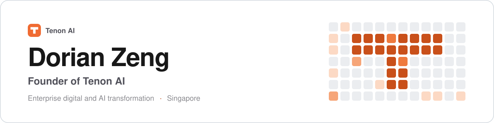
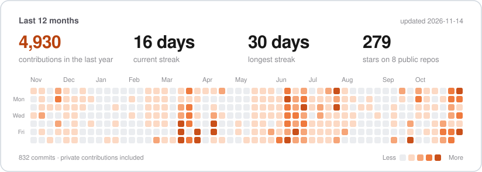

<picture>
  <source media="(prefers-color-scheme: dark)" srcset="assets/banner-dark.svg">
  
</picture>

  
  
  
  
  

I build agent systems that survive contact with real workflows: operable, auditable, recoverable, and bounded by explicit permissions.

**Now**

- Building [Tenon AI](https://tenonai.cn/): enterprise digital and AI transformation, plus seven products

## Building Tenon AI

<table>
<tr>
<td width="50%" valign="top">

<b><a href="https://tenonai.cn/products/agenthub/">AgentHub</a></b> 
The control platform for enterprise agent clusters
 

Rebuilt from scratch: one instance per server, a model-gateway key per agent tied to its lifecycle, controlled delegation and multi-agent workflows on a canvas.

<a href="https://agenthub.tenonai.cn/">Live instance</a> · <a href="https://tenonai.cn/products/agenthub/">Details</a>
</td>
<td width="50%" valign="top">
<picture><source media="(prefers-color-scheme: dark)" srcset="assets/icons/inthub-dark.svg"></picture>
<b><a href="https://github.com/dozybot001/Intent">Intent CLI</a> / <a href="https://tenonai.cn/products/inthub/">IntHub</a></b> 
Semantic Git for the vibe coding era, and its cloud home
 

Intent, Snap and Decision keep goals, verified progress and durable decisions next to your code; a CLI, an Agent Skill and project hooks give each new session a place to start.

<a href="https://github.com/dozybot001/Intent">Repository</a> · <a href="https://inthub.tenonai.cn/">IntHub</a>
</td>
</tr>
<tr>
<td width="50%" valign="top">

<b><a href="https://tenonai.cn/products/caret/">Caret</a></b> 
An ultralight coding agent in your browser
 

Three tools: read, write and edit. No install, no account and no application server; changes stay in the editor until you have read the diff.

<a href="https://caret.tenonai.cn/">Open Caret</a> · <a href="https://github.com/dozybot001/Caret">Repository</a>
</td>
<td width="50%" valign="top">

<b><a href="https://tenonai.cn/products/jig/">Jig</a></b> 
An AI-native multi-agent workbench
 

Born for Session Engineering. You deal only with the main conversation, and approvals and decisions sit in the approval center, on your phone too.

Used inside Tenon AI · <a href="https://tenonai.cn/products/jig/">Details</a>
</td>
</tr>
<tr>
<td width="50%" valign="top">

<b><a href="https://tenonai.cn/products/wesaid/">WeSaid</a></b> 
A secret exchange app built on equal terms
 

Private wish pools, mutual matching, dual acceptance and a transactional reveal make safety part of the interaction rather than a policy page.

<a href="https://apps.apple.com/us/app/wesaid/id6795870332">App Store</a> · <a href="https://wesaid.tenonai.cn/">Web</a>
</td>
<td width="50%" valign="top">

<b><a href="https://tenonai.cn/products/passby/">PassBy</a></b> 
A simple password notebook
 

A native SwiftUI password notebook for iPhone.

<a href="https://apps.apple.com/app/passby-password-notebook/id6817881529">App Store</a>
</td>
</tr>
</table>

Shared infrastructure: an OIDC + PKCE account service (sign-up, email verification, recovery, social sign-in and cross-product deletion) with an integration spec adopted by every product with sign-in, plus one UI/UX standard. Also on GitHub: [ai-cultivation](https://github.com/dozybot001/ai-cultivation), a framework for growing AI from a temporary helper into an auditable, explicitly authorized personal proxy.

## Production work

<table>
<tr>
<td width="50%" valign="top">
<b>AgentHub</b> 
Enterprise agent management platform

Agent creation, runtime, control and collaboration in one platform, now run by multiple maintainers.

</td>
<td width="50%" valign="top">
<b>SimReadyGen</b> 
AI 3D asset SaaS for global users

An early internal capability turned into a product within three weeks: 486 external accounts and an 86.3% delivery rate.

</td>
</tr>
<tr>
<td width="50%" valign="top">
<b>SimReadyGen API</b> 
Internal 3D asset generation service

One entry point for colleagues, agents and scripts, running in three environments; 2,249 tasks submitted.

</td>
<td width="50%" valign="top">
<b>BatchRefresh</b> 
Production batch reprocessing platform

Manual scripts replaced by validation, approval, batch rerun and audit; up to 900,000 records in one batch.

</td>
</tr>
<tr>
<td colspan="2" valign="top">
<b>Sample Platform</b> 
Sample showcase and customer delivery

Customers preview, request and collect samples in one place; all 105 automated tests pass, in internal beta.

</td>
</tr>
</table>

Five systems I led during an internship (May 2026 – present). Figures are as of October 30, 2026; details are in my [profile](https://tenonai.cn/resume/).

## GitHub activity

<picture>
  <source media="(prefers-color-scheme: dark)" srcset="assets/activity-dark.svg">
  
</picture>

## Writing

<!-- writing:start -->
- [Session Engineering, part 2: one session between me and the rest](https://tenonai.cn/blog/session-engineering-chief-of-staff/) 2026-11-08
- [Session Engineering: organizing agent sessions is also managing your own context](https://tenonai.cn/blog/session-engineering/) 2026-11-06
- [Writing every interaction into the model](https://tenonai.cn/blog/parametric-memory/) 2026-10-31
- [Dynamic intelligence: models that change as they run](https://tenonai.cn/blog/dynamic-intelligence/) 2026-10-31
<!-- writing:end -->

More at [tenonai.cn/blog](https://tenonai.cn/blog/).

## Engineering principles

- **Capability is only the beginning.** Identity, permissions, state, and recovery determine whether an agent can enter a real workflow.
- **One truth, explicit boundaries.** Ownership and lifecycle state belong on the server; projections and clients must not silently redefine them.
- **Human intervention is a product path.** HITL work needs queues, claim/release semantics, quality control, escalation, and a route back into automation.
- **A release should be reproducible.** I prefer commit-exact builds, immutable artifacts, candidate slots, public acceptance, and rollback over production-side improvisation.
- **Safety can be interaction design.** The strongest guardrail is often a mechanism users can understand, not another paragraph in a policy page.

## Toolbox

  
  
  
  
  
  
  
  
  

## Background

- M.Sc. Signal Processing and Machine Learning, Nanyang Technological University · Jan 2026 – Jan 2027
- B.Eng. Electrical Engineering, Shanghai Jiao Tong University · 2020 – 2024

The banner, activity card and writing list are rebuilt daily by GitHub Actions from public data.
