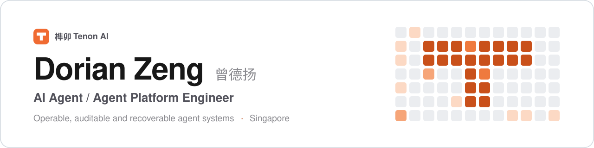
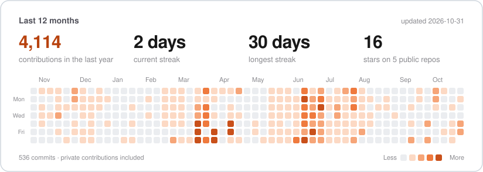

<picture>
  <source media="(prefers-color-scheme: dark)" srcset="assets/banner-dark.svg">
  
</picture>

  
  
  
  
  

I build agent systems that survive contact with real workflows: operable, auditable, recoverable, and bounded by explicit permissions.

> 我关注的不只是 Agent 能否完成一次任务，而是它能否被安全地创建、授权、协作、恢复并长期运营。

**Now**

- AI Agent Engineer Intern at [Lightwheel](https://www.lightwheel.ai/) · May 2026 – present
- Building [榫卯 Tenon AI](https://tenon.asia/): four products and the infrastructure they share
- M.Sc. Signal Processing and Machine Learning, NTU · until Jan 2027
- Open to AI Agent / Agent Platform engineering roles · available Dec 3, 2026

## Work at Lightwheel

<table>
<tr>
<td width="33%" valign="top">
<b>AgentHub</b> 
Enterprise Agent Control Plane

One control plane for agent creation, credential handoff, deployment, upgrades, sessions and retirement; token-first authorization over 96 standardized operations.

 

</td>
<td width="33%" valign="top">
<b>SimReadyGen</b> 
AI 3D asset SaaS for global users

From a website shell to a full SaaS in 22 days: sign-up, top-up, generation, human correction and delivery on one central state machine.

 

</td>
<td width="33%" valign="top">
<b>BatchRefresh</b> 
Production batch reprocessing

Manual scripts replaced by select → preview → confirm → execute → recover → audit, with atomic claims, pause/resume and reconciliation.

 

</td>
</tr>
</table>

Figures as in my [résumé](https://tenon.asia/resume/) (updated 2026-10-26).

## Building 榫卯 Tenon AI

<table>
<tr>
<td width="50%" valign="top">

<b><a href="https://tenon.asia/products/agenthub/">AgentHub</a></b> 
AI agent fleet control plane · personal edition
 

Rebuilt from scratch: one instance per server, a model-gateway key per agent tied to its lifecycle, controlled delegation and sequential multi-agent workflows.

<a href="https://agenthub.tenon.asia/">Live instance</a> · <a href="https://tenon.asia/products/agenthub/">Details</a>
</td>
<td width="50%" valign="top">
<picture><source media="(prefers-color-scheme: dark)" srcset="assets/icons/inthub-dark.svg"></picture>
<b><a href="https://github.com/dozybot001/Intent">Intent</a> / <a href="https://tenon.asia/products/inthub/">IntHub</a></b> 
Semantic history for agent-driven development
 

Intent, Snap and Decision keep goals, verified progress and durable decisions above Git; a CLI, an Agent Skill and Codex hooks give each new session a place to start.

<a href="https://github.com/dozybot001/Intent">Repository</a> · <a href="https://inthub.tenon.asia/">IntHub</a>
</td>
</tr>
<tr>
<td width="50%" valign="top">

<b><a href="https://tenon.asia/products/wesaid/">WeSaid</a></b> 
Equitable one-to-one secret exchange
 

Private wish pools, mutual matching, dual acceptance and a transactional reveal make safety part of the interaction rather than a policy page.

<a href="https://apps.apple.com/us/app/wesaid/id6795870332">App Store</a> · <a href="https://wesaid.tenon.asia/">Web</a> · <a href="https://github.com/dozybot001/WeSaid">Repository</a>
</td>
<td width="50%" valign="top">

<b><a href="https://tenon.asia/products/passby/">PassBy</a></b> 
Private password notebook
 

A native SwiftUI password notebook for iPhone, with a web version for the desktop.

<a href="https://apps.apple.com/app/passby-password-notebook/id6817881529">App Store</a> · <a href="https://passby.tenon.asia/">Web</a>
</td>
</tr>
</table>

Shared infrastructure: an OIDC + PKCE account service (sign-up, email verification, recovery, social sign-in and cross-product deletion) with an integration spec adopted by all four products, plus one UI/UX standard. Also on GitHub: [ai-cultivation](https://github.com/dozybot001/ai-cultivation), a framework for growing AI from a temporary helper into an auditable, explicitly authorized personal proxy.

## GitHub activity

<picture>
  <source media="(prefers-color-scheme: dark)" srcset="assets/activity-dark.svg">
  
</picture>

## Writing

<!-- writing:start -->
- [老框架，新部件：用 Jev 让概率模型自己建、自己更新](https://tenon.asia/blog/jev-live-models/) 2026-10-23
- [Jev 能用来做什么：从概率门到可计算的信念模型](https://tenon.asia/blog/jev-applications/) 2026-10-23
- [概率门实验：Jev 的概率能直接用吗](https://tenon.asia/blog/probability-gates-experiments/) 2026-10-23
- [概率门：从比特到概率的电路](https://tenon.asia/blog/probability-gates/) 2026-10-22
<!-- writing:end -->

More at [tenon.asia/blog](https://tenon.asia/blog/).

## Engineering principles

- **Capability is only the beginning.** Identity, permissions, state, and recovery determine whether an agent can enter a real workflow.
- **One truth, explicit boundaries.** Ownership and lifecycle state belong on the server; projections and clients must not silently redefine them.
- **Human intervention is a product path.** HITL work needs queues, claim/release semantics, quality control, escalation, and a route back into automation.
- **A release should be reproducible.** I prefer commit-exact builds, immutable artifacts, candidate slots, public acceptance, and rollback over production-side improvisation.
- **Safety can be interaction design.** The strongest guardrail is often a mechanism users can understand, not another paragraph in a policy page.

## Toolbox

  
  
  
  
  
  
  
  
  

## Background

- M.Sc. Signal Processing and Machine Learning, Nanyang Technological University · Jan 2026 – Jan 2027 · GPA 4.13 / 5.0
- B.Eng. Electrical Engineering, Shanghai Jiao Tong University · 2020 – 2024

The banner, activity card and writing list are rebuilt daily by GitHub Actions from public data.
